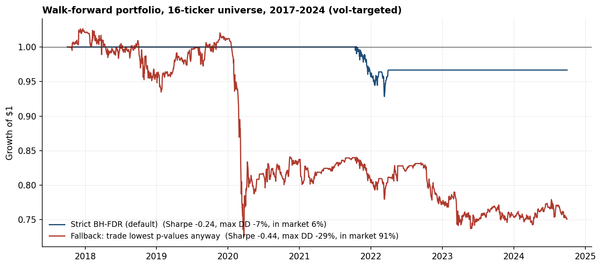
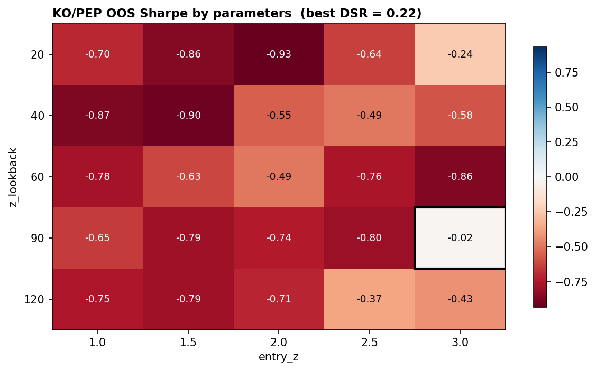
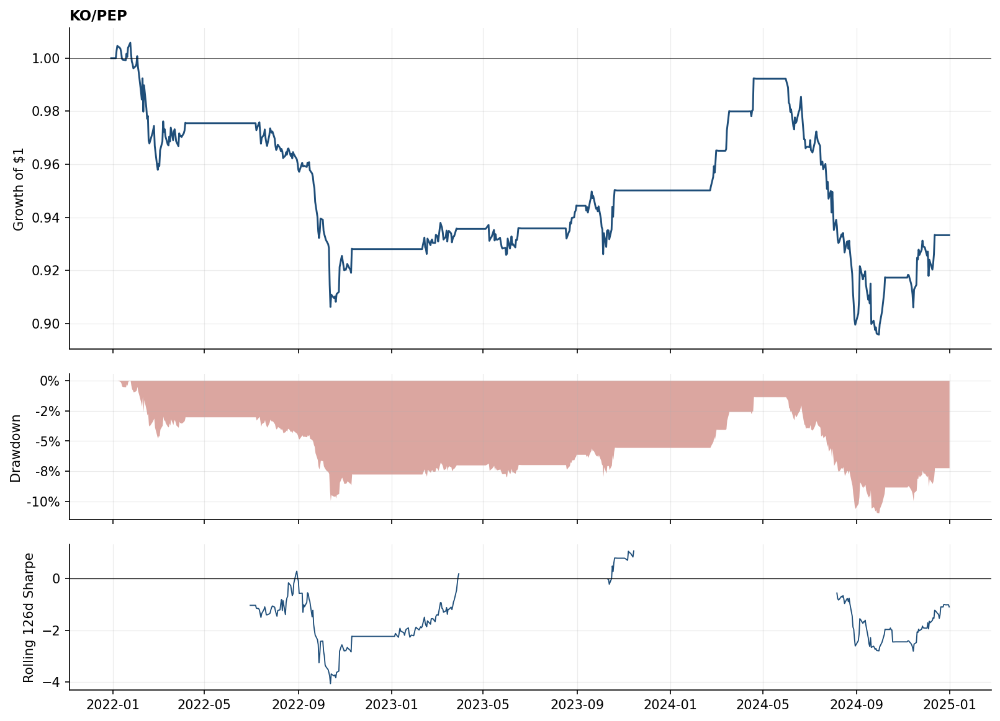
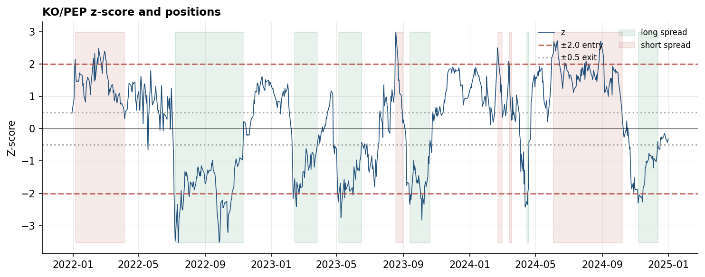

# Statistical Arbitrage Research Pipeline

[](https://github.com/Space-Paragon1/Statistical-Arbitrage-pipeline/actions/workflows/ci.yml)


[](LICENSE)

A pairs-trading research pipeline built around one question: **does the edge survive honest testing?**

Most pairs-trading backtests answer a different question: can I find a pair and parameters that looked good? This pipeline is built so that it can tell you **not** to trade. Every number below is out of sample. Each claim about rigor is enforced by a test, and the headline result is a strategy the pipeline declines to trade.

```
data ─▶ prefilter ─▶ Engle-Granger ─▶ BH-FDR ─▶ rank on VAL ─▶ deflate ─▶ size & allocate ─▶ asset-level engine
         (TRAIN)       (TRAIN)        (all pairs)   (frozen β)     (DSR)      (TRAIN+VAL only)    (costs, borrow, netting)
```

---

## Results (2015–2024, daily, out of sample)

### 1. On a 16-ticker US universe, the pipeline declines to trade, and that is the right call

The quarterly walk-forward portfolio selects pairs on two years of training data plus six months of validation, then trades the next quarter. In **26 of 28 quarters** no pair survived Benjamini-Hochberg FDR control, so the book stayed flat. If you force it to trade the lowest p-values anyway (the "fallback" that v0.1 used silently), it is in the market 91% of the time and draws down 29%.



| Portfolio (vol-targeted) | Sharpe | CAGR | Max DD | Time in market | Turnover / yr |
|---|---:|---:|---:|---:|---:|
| Strict BH-FDR (default) | −0.24 | −0.5% | −7.2% | 6% | 0.9× |
| Fallback: lowest p-values | −0.44 | −4.0% | −29.3% | 91% | 24.1× |

Every quarter's selection is logged in [`docs/figures/portfolio_vol_target_quarters.csv`](docs/figures/portfolio_vol_target_quarters.csv): candidates, pairs tested, FDR survivors, pairs traded, sizes and breaker state.

The two quarters that did pass FDR (Q4 2021 and Q1 2022) were trained on windows that contained the COVID crash. PEP-vs-index pairs looked cointegrated in that window but weren't afterwards, which is a textbook structural break.

### 2. KO/PEP, the textbook pair, has no out-of-sample edge, and it isn't a parameter problem

| KO/PEP walk-forward (daily OLS refit) | In-sample 2015–2021 | Out-of-sample 2022–2024 |
|---|---|---|
| Engle-Granger p-value | **0.026** | — |
| Sharpe [95% stationary-bootstrap CI] | — | **−0.49** [−1.61, 0.75] |
| Probabilistic Sharpe Ratio P(SR > 0) | — | 0.20 |
| Hit rate / avg trade | — | 73% / −0.57% (many small wins, few large losses) |

All 25 `(z_lookback, entry_z)` configurations lose money out of sample. The best cell's Sharpe (−0.02) is below the **0.44** you'd expect from the best of 25 skill-less strategies by luck alone, giving a **Deflated Sharpe Ratio of 0.22**.



<details>
<summary>KO/PEP tearsheet and positions</summary>




</details>

Reproduce everything above with `make results` (downloads once, then caches under `data/cache/`).

---

## What makes it rigorous

Every guarantee below is enforced in code **and** checked by a named test.

| Guarantee | How it is enforced | Test |
|---|---|---|
| **No lookahead** | Hedge params at *t* are fit on `[t−T, t)`; positions are lagged one bar; portfolio sizing and allocation use TRAIN+VAL only | [`test_lookahead.py`](tests/test_lookahead.py) corrupts every price after date *T* and requires **bit-identical** output up to *T* for the pair backtest (OLS and Kalman) and the full portfolio walk-forward |
| **Backtest = live** | One signal path (`compute_pair_signals` + `next_state`) shared by the backtest and the live runner | `test_live_signal_matches_backtest` replays history through the live code and must reproduce every backtest decision |
| **Correct hedge units** | β from a price regression is a *share* ratio and is converted to dollar weights with prices | `test_pair_pnl_equals_spread_pnl`: engine P&L ≡ ΔSpread / gross notional, to 1e-12 |
| **Valid cointegration p-values** | Engle-Granger test with MacKinnon critical values, not plain ADF on fitted residuals | `test_engle_granger_rejects_independent_random_walks` (≈5% size), `…_more_conservative_than_naive_adf` |
| **Multiple-testing control** | Benjamini-Hochberg across *all* tested pairs; strict by default (no silent fallback) | `test_benjamini_hochberg_matches_statsmodels`, `test_scan_report_strict_fdr` |
| **Selection-bias haircut** | Deflated Sharpe Ratio (Bailey & López de Prado, 2014) on every selected pair and parameter sweep | `test_probabilistic_and_deflated_sharpe`, `test_parameter_sweep_deflates_best_cell` |
| **Honest costs** | One asset-level engine with drift-adjusted turnover, cross-pair netting, quarter-boundary entries/exits and short borrow | `test_backtest_weights_hand_computed`, `test_costs_charged_at_quarter_boundaries` |
| **Honest uncertainty** | Stationary block bootstrap (Politis & Romano, 1994) for autocorrelated returns | `test_block_bootstrap_is_wider_for_autocorrelated_returns` |
| **Real shrinkage** | Exact Ledoit-Wolf (2004) estimator, no sklearn dependency | `test_ledoit_wolf_matches_sklearn` (to 1e-10) |
| **Risk controls that work** | Drawdown breaker on *current* drawdown with re-arming; daily gross-exposure cap | `test_drawdown_breaker_rearms`, `test_gross_exposure_cap` |

113 tests, 93% branch coverage, about 15 s. CI runs ruff, mypy and pytest on Python 3.10–3.13.

---

## Methodology

### Model and timing

For a pair (Y, X), each day *t* the pipeline:

1. fits `Y = α + β·X` on the previous `T` days, `[t−T, t)` (rolling OLS, or the one-step-ahead prior of a Kalman filter);
2. computes the spread `sₜ = Yₜ − αₜ − βₜXₜ` and its z-score over a trailing window evaluated with **today's** parameters (O(n) via rolling moments; tested equal to brute-force recomputation);
3. updates a position state machine at the close: enter at |z| ≥ `entry_z`, take profit once z reverts past `exit_z`, plus optional `stop_z` stop-loss and `max_holding` time stop (with re-entry lockout);
4. **holds that position over the next bar**. One unit of spread is +1 share of Y and −β shares of X, so dollar weights are `(P_Y, −β·P_X)` scaled to the target gross leverage.

```
close t-1                     close t                       close t+1
   │  params fit on [t-T, t)     │  observe z_t, decide pos      │
   │──── hold pos_{t} ──────────▶│──── hold pos_{t+1} ──────────▶│
                                 trade at close t, cost booked on bar t+1
```

### Pair selection (`sarb scan`, and every quarter in `sarb portfolio`)

1. **Prefilter** on TRAIN returns: |correlation| ≥ threshold, or OPTICS/DBSCAN clustering on standardized returns (`--prefilter ml`).
2. **Engle-Granger** cointegration p-value on TRAIN prices.
3. **Benjamini-Hochberg** at `q` across every tested pair. If nothing survives, nothing is traded.
4. **Rank** survivors by VALIDATION Sharpe with the hedge ratio frozen from TRAIN, and report each one's **Deflated Sharpe** given the number of pairs tried.

### Portfolio construction (`sarb portfolio`)

* Per-pair **volatility targeting** estimated on TRAIN+VAL returns.
* Allocation: equal weight, or **long-only minimum variance on the Ledoit-Wolf covariance** (correlated pairs share a risk budget).
* Per-pair caps, a **daily gross-exposure cap**, and a **drawdown breaker** that flattens for one quarter, then re-arms from a fresh high-water mark.
* Pair books are summed into a dated **asset-level weight matrix** and simulated once, so costs reflect real trades, including netting when two pairs share a ticker.

### Cost model

`cost = turnover × (fee_bps + slippage_bps)`, where turnover is `Σ|wₜ − w̃ₜ₋₁|` and `w̃` is yesterday's weights after drifting with yesterday's returns. Holding shares costs nothing; only real trades do. Short borrow is charged daily on short notional (`--borrow-bps`, annualized).

---

## Quickstart

```bash
pip install -e ".[all]"          # Python 3.10+

sarb backtest                     # KO/PEP walk-forward, OOS metrics, bootstrap CI, figures
sarb backtest --hedge kalman --stop-z 3.5 --max-holding 90
sarb scan                         # FDR-controlled universe scan, evaluated on an untouched test set
sarb portfolio                    # quarterly walk-forward portfolio: equal / vol-target / risk-managed
sarb sweep                        # parameter grid with a deflated-Sharpe haircut
sarb paper                        # replay history through the live runner and paper broker
sarb <command> --help             # every option
```

Every command accepts `--prices-csv path.csv` (wide Date × ticker) for fully offline, frozen-data reproduction. The old `scripts/*.py` entry points still work as thin wrappers around the CLI.

The library is importable directly:

```python
from sarb.data.ingest import load_yfinance_prices
from sarb.backtest.walkforward import walkforward_pairs_backtest
from sarb.metrics.performance import performance_summary

px = load_yfinance_prices(["KO", "PEP"], "2015-01-01", "2025-01-01")
bt = walkforward_pairs_backtest(
    px,
    "KO",
    "PEP",
    train_lookback=504,
    z_lookback=60,
    entry_z=2.0,
    exit_z=0.5,
    fee_bps=1.0,
    slippage_bps=0.5,
)
performance_summary(bt.loc["2022":])
```

---

## Project layout

```
src/sarb/
├── cli.py                    # `sarb` command-line entry point
├── config.py                 # defaults and the research universe
├── data/ingest.py            # Yahoo Finance / CSV loaders with on-disk cache
├── features/
│   ├── spread.py             # rolling OLS hedge, O(n) time-varying z-score, shared signal path
│   └── kalman.py             # online Kalman hedge ratio (prior/posterior timing documented)
├── strategy/pairs.py         # entry/exit/stop/time-stop state machine (shared with live)
├── backtest/
│   ├── engine.py             # asset-level weight engine; pair → dollar-weight conversion
│   └── walkforward.py        # daily-refit single-pair walk-forward backtest
├── research/
│   ├── select_pairs.py       # prefilter → Engle-Granger → BH-FDR → rank → DSR
│   ├── walkforward_portfolio.py  # quarterly multi-pair walk-forward portfolio
│   ├── sweep.py              # parameter grid + deflated Sharpe of the best cell
│   └── ml_select.py          # OPTICS/DBSCAN prefilter on correlation distance
├── stats/
│   ├── cointegration.py      # Engle-Granger (MacKinnon), ADF, OU half-life
│   ├── multiple_testing.py   # Benjamini-Hochberg
│   ├── bootstrap.py          # stationary block bootstrap CIs
│   └── sharpe_inference.py   # PSR, deflated Sharpe, expected max Sharpe
├── portfolio/vol_target.py   # per-pair volatility targeting
├── risk/
│   ├── covariance.py         # Ledoit-Wolf shrinkage, long-only min-variance weights
│   └── limits.py             # position/gross caps, re-arming drawdown breaker, borrow
├── live/                     # broker interface, paper broker, live runner (state carried, netted orders)
└── viz/                      # tearsheet, spread/z-score, heatmap (object-oriented matplotlib)

tests/                        # 113 tests, all synthetic data, no network
notebooks/01_eda_pairs.ipynb  # guided walkthrough, including why naive ADF over-rejects
scripts/make_readme_figures.py
```

## Development

```bash
make install     # editable install with dev extras
make check       # ruff + format check + mypy + pytest (what CI runs)
make results     # regenerate README figures and numbers
pre-commit install
```

## Limitations and next steps

* **Survivorship bias.** The universe is today's familiar large caps and ETFs. A point-in-time constituent list (for example historical S&P 500 membership) would remove it.
* **Small universe.** 16 tickers give 120 pairs. Sector- or industry-matched candidates over a broad universe is the natural next step, with FDR control doing more work as the number of tests grows.
* **Execution.** Fills happen at the signal close (a market-on-close assumption) with linear costs; there's no market-impact model and no borrow-availability constraint.
* **Engle-Granger asymmetry.** EG tests Y on X only. Johansen's test is symmetric and handles baskets of more than two assets.
* **Structural breaks.** The test above caught the COVID-era false positives after the fact. A break test such as CUSUM on the spread, or a regime filter, could catch them before trading.

See [CHANGELOG.md](CHANGELOG.md) for the v0.2 methodology corrections and their before/after impact.

## License

MIT. See [LICENSE](LICENSE).
